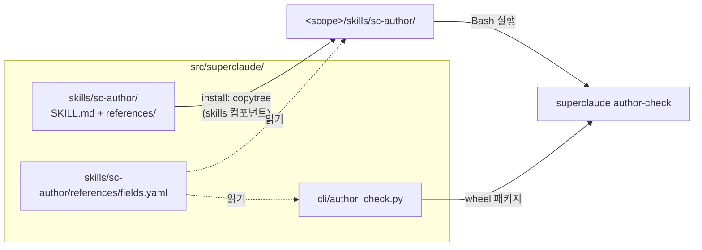
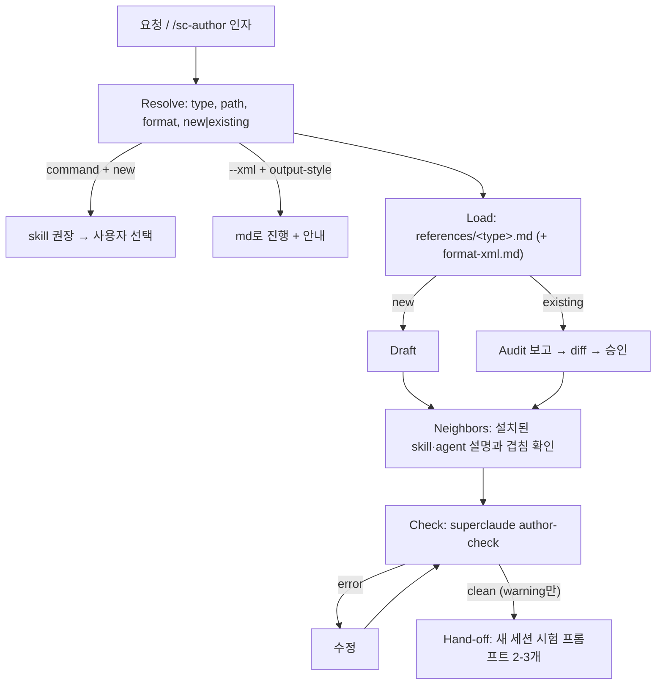

# `sc-author` 스킬 — 설계

유형: architecture. 다루는 것: 스킬 패키지 구성, 실행 흐름, 검사기(`superclaude author-check`) 인터페이스, `skills` 설치 컴포넌트, 저장소 규칙의 SSOT 이동, 검증 방법. 구현 코드는 다루지 않는다.

## 1. 입력

2026-10-10 세션에서 사용자가 정한 것:

| # | 결정 | 근거 |
|---|---|---|
| D1 | 배포판(`superclaude install`)에 넣는다. 대상은 SuperClaude를 설치한 사용자 프로젝트 | 사용자: "superclaude를 설치하여 사용하는 프로젝트에서 추가로 만들 때 너무 형식없이 만들어져" |
| D2 | 기본 형식은 Claude Code·Anthropic 공식 권장 구조(`--md`) | 사용자 선택 |
| D3 | `--xml` 플래그로 SuperClaude 컴포넌트 형식도 지원 | 사용자 요청 |
| D4 | 자동 트리거 (평범한 "에이전트 만들어줘"에도 발동) | 사용자 선택 |
| D5 | 커맨드가 아니라 스킬로 배포 | 사용자: "skill이 더 좋지 않아?" → 참고 파일 묶음이 핵심 (§7 C1) |
| D6 | XML 규칙의 원본은 배포 파일. XML 규칙 검증 필요 | 사용자 |
| D7 | 선행 수정: 저장소 규칙의 사실 오류 정정 | 커밋 `95d77d84` |
| D8 | `--xml` 허용 범위: skill·agent·command·memory. output style만 md 고정 | 인터뷰 (§9-7) |
| D9 | 스킬 이름 `sc-author` (`/sc-author`) | 인터뷰 (§9-2) |
| D10 | 품질 원칙도 배포 파일(`quality.md`)이 원본. 저장소 규칙은 SuperClaude 전용 부분 + `@import` | 인터뷰 (§9-5) |

외부 근거 (2026-10-10 조회, 문서에 날짜 없음 → 조회일 기준):

- Skill authoring best practices — `platform.claude.com/docs/en/agents-and-tools/agent-skills/best-practices`
- Claude Code skills / sub-agents / output-styles / memory — `code.claude.com/docs/en/{skills,sub-agents,output-styles,memory}`
- Prompting best practices — `platform.claude.com/docs/en/build-with-claude/prompt-engineering/claude-prompting-best-practices`
- `anthropics/skills` skill-creator, `obra/superpowers` writing-skills, `anthropics/claude-plugins-official` plugin-dev·claude-md-management

## 2. 범위

포함:
- 문서 유형 5종: `skill`, `agent`, `command`, `output-style`, `memory`(CLAUDE.md + `.claude/rules/*.md`)
- 새로 쓰기 + 기존 파일 고치기(감사 → diff → 승인 → 쓰기)
- 형식 선택: `--md` | `--xml` | 미지정
- 기계 검사: frontmatter, 필드, 길이, 참조, XML 구조
- `skills` 설치 컴포넌트 (install / uninstall / git-exclude / verify-drift / inventory)

제외:
- mode, MCP 문서: SuperClaude `context_loader` 전용 개념이라 사용자 프로젝트에 의미 없음
- hooks 작성: 별도 영역(`update-config` 스킬이 담당)
- 트리거 정확도 최적화 루프: skill-creator가 이미 제공 (§8 deferred)
- claude.ai·Codex 이식성: `portable-skills/` 경로가 따로 있음

## 3. 아키텍처

### 3.1 배포 경로



- `<scope>`: user → `~/.claude/`, project·local → `./.claude/` (`install_paths.get_base_path`)
- `fields.yaml`은 스킬(모델이 읽음)과 검사기(코드가 읽음)가 같은 파일을 쓴다 → 필드 목록의 원본이 하나

### 3.2 실행 흐름



- Check 반복 상한 3회 → 넘으면 남은 error를 보고하고 멈춤

## 4. 컴포넌트와 인터페이스 계약

### C1. 스킬 패키지

```
src/superclaude/skills/sc-author/
├── SKILL.md                 절차만 (목표 ≤150줄)
└── references/
    ├── fields.yaml          유형별 frontmatter 필드 (SSOT, 검사기도 읽음)
    ├── skill.md             위치·frontmatter·md 본문 템플릿·유형 함정
    ├── agent.md
    ├── command.md           legacy 안내 + skill 권장
    ├── output-style.md
    ├── memory.md            CLAUDE.md + .claude/rules
    ├── format-xml.md        XML 본문 규칙 (SSOT, D6) + skill·agent·command·memory XML 골격
    └── quality.md           공통 품질 기준 (SSOT, D10) + 감사 체크리스트
```

- 참조 깊이 1단계: 모든 참고 파일은 SKILL.md에서 직접 링크. 참고 파일끼리 링크하지 않음
- 100줄 넘는 참고 파일은 맨 위에 목차
- md 형식 규칙은 별도 파일 없이 각 `<type>.md` 템플릿에 포함 (§8)
- 경로 표기: `${CLAUDE_SKILL_DIR}/references/<file>` (Claude Code가 본문에서 치환)

### C2. SKILL.md 계약

frontmatter:

| 필드 | 값 |
|---|---|
| `name` | `sc-author` → 호출 `/sc-author` |
| `description` | 능력 한 줄 + 트리거 + 부정 게이트. 절차 요약 금지. 목표 ≤600자 (상한 1,536) |
| `argument-hint` | `[skill|agent|command|output-style|memory] [무엇을] [--md|--xml]` |
| `allowed-tools` | `Bash(superclaude author-check *)` → 검사기 실행에 권한 확인 없음 |

description 초안 (영어 — 배포 콘텐츠는 언어 중립):

> Write or revise the Markdown files Claude Code reads — skills (SKILL.md), subagents (.claude/agents/), slash commands, output styles, CLAUDE.md and .claude/rules — with valid frontmatter, a consistent body structure (--md default, --xml for SuperClaude-style XML bodies) and a validator pass. Use when the user asks to create, write, restructure or review one of these files, or types /sc-author. Do NOT trigger for running or debugging an existing skill or agent, for prompts sent to the API (/sc:prompt), or for measuring a skill with evals (skill-creator).

본문 절차 (Numbered, 각 단계는 라벨로 시작):

1. Resolve
   - type: 인자 → 요청 문맥 → 모호하면 질문
   - path: 유형별 기본 위치(`fields.yaml`의 `location`) + scope(project 기본, 사용자가 개인용이라 하면 user)
   - format: `--xml` | `--md` | 미지정 → 기존 파일이면 현재 형식, 새 파일이면 md
   - `command` + 새 파일 → "Claude Code는 새 작업에 skill 권장" 안내 후 선택받기
   - `--xml` + `output-style` → md로 진행, 이유 한 줄 안내 (D8)
2. Load: `references/<type>.md` + (xml이면) `references/format-xml.md`
3. Draft | Audit
   - new → 템플릿으로 초안
   - existing → `quality.md` 체크리스트 + 검사기로 감사 보고 → diff 제시 → 승인 후 쓰기
4. Neighbors: 같은 scope와 user scope의 skill·agent 이름+설명 수집 → description의 트리거가 겹치면 구분 문구를 넣음
5. Check: `superclaude author-check <path> --type <t> --format <f>` → error 수정 → 재실행 (상한 3)
6. Hand-off: 새 세션에서 돌릴 프롬프트 2-3개 제시 (발동해야 할 것 1-2 + 비슷하지만 발동하면 안 되는 것 1)

### C3. 참고 파일 계약

| 파일 | 담는 것 | 읽는 시점 |
|---|---|---|
| `fields.yaml` | 유형별 `location`, `required`, `optional`, `unsupported`(그 유형에서 Claude Code가 무시하는 필드), 길이 상한, 출처 URL + 조회일 | Resolve, Check(검사기) |
| `<type>.md` | 언제 이 유형을 쓰나(다른 유형과 구분) · md 본문 템플릿 · 유형 함정 | Load |
| `format-xml.md` | XML 본문 규칙 + skill/agent/command/memory XML 골격 | Load (`--xml`) |
| `quality.md` | 삭제 테스트, 트리거/설명문, 절차·참고 분리, 강한 용어, 내용 수명, 강조 대신 이유, 긍정형, 일관 용어, 예시 | Audit, Draft 마무리 |

유형 함정 (각 `<type>.md`에 들어갈 핵심):
- skill: description은 3인칭, 능력+트리거, 절차 요약 금지 · 본문 <500줄 · 참고 1단계 · 부작용 있는 작업은 `disable-model-invocation: true`
- agent: 본문이 곧 시스템 프롬프트 → 부모 대화 문맥 없음, 자기완결 · description = "언제 위임하나" · `name`에 `:` 금지
- command: `.claude/commands/`는 legacy · `name`, `paths` 미지원
- output-style: `keep-coding-instructions` 기본값 false → 코딩 프로젝트면 true · 사실·지식은 CLAUDE.md로
- memory: CLAUDE.md <200줄 · 구체적 지시("2칸 들여쓰기") · 서로 모순되는 지시 금지 · rules frontmatter는 `paths`만 읽힘 · 강제가 필요하면 hook

### C4. 검사기 `superclaude author-check`

```
superclaude author-check <path> [--type skill|agent|command|output-style|memory]
                                [--format md|xml]
```

- `--type` 생략 → 경로로 추론 (`*/skills/*/SKILL.md` → skill, `*/agents/*.md` → agent, `*/commands/**.md` → command, `*/output-styles/*.md` → output-style, `CLAUDE.md`·`*/rules/**.md` → memory) → 추론 실패면 exit 2
- `--format` 생략 → 본문 첫 비공백 줄이 `<태그>`면 xml, 아니면 md
- 출력: 한 줄에 하나 `path:line: CODE message`, 마지막 줄 요약 `N errors, M warnings`
- exit: 0 = error 없음 · 1 = error 있음 · 2 = 사용법 오류·추론 실패
- 의존성: 표준 라이브러리 + PyYAML(이미 의존성) — 새 의존성 없음
- 위치: `src/superclaude/cli/author_check.py` + `main.py`에 click 명령 등록 (기존 `verify-drift`와 같은 평면 이름)

규칙:

| 코드 | 등급 | 조건 |
|---|---|---|
| F1 | error | frontmatter 없음(필요한 유형) 또는 YAML 파싱 실패 — Claude Code는 이 경우 필드 없이 조용히 로드 |
| F2 | error | `required` 필드 누락 |
| F3 | error | 그 유형의 `unsupported` 필드 사용 (예: command의 `name`·`paths`) — 조용히 무시됨 |
| F4 | warning | `fields.yaml`에 없는 필드 — Claude Code가 새 필드를 추가했을 수 있으므로 error 아님 |
| F5 | error | 이름 규칙 위반 (skill: 소문자·숫자·하이픈, ≤64 / agent: `:` 금지) |
| F6 | error | skill `description` + `when_to_use` > 1,536자 (목록에서 잘림) |
| F7 | warning | description 1인칭·2인칭 ("I can", "You can") |
| R1 | error | SKILL.md가 링크한 참고 파일 없음 |
| R2 | warning | 참고 파일이 다른 참고 파일을 링크 (깊이 >1) |
| R3 | warning | 100줄 넘는 참고 파일에 목차 없음 |
| S1 | warning | 길이 초과: SKILL.md >500줄, CLAUDE.md·rules >200줄 |
| S2 | warning | 대문자 강조어(MUST, ALWAYS, NEVER, CRITICAL, IMPORTANT) 3회 이상 |
| X1 | error | (xml) 루트 요소가 정확히 하나가 아님, 또는 루트 밖에 맨 텍스트 |
| X2 | error | (xml) 태그 짝 불일치·잘못된 중첩 (코드 펜스·인라인 코드는 가린 뒤 파싱) |
| X3 | error | (xml) 태그 이름이 `snake_case` 아님 |
| X4 | error | (xml) 중첩 깊이 >3 (root → section → sub → item) |
| X5 | warning | (xml) `<example>` 밖 본문에 Markdown 헤더 |
| X6 | error | (xml) 슬롯 이름 `<should>`·`<avoid>` (모델이 선택 사항으로 읽음) |
| X7 | error | `--format xml`인데 output-style 유형 (D8 범위 밖) |

### C5. `skills` 설치 컴포넌트

현재 상태 (근거):
- `install_paths.COMPONENTS`에 skills 없음, `templates`만 하위 디렉터리를 `copytree` (`install_components.py:183-211`)
- `SHARED_TARGET_COMPONENTS = ("agents", "output-styles")` — 파일 이름 단위 (`shipped_md_names`)
- 커밋 `910eabdd`(2026-08-31)가 skills 레이어 전체 삭제: `install_skill.py`, doctor·verify-drift 분기, main.py 명령 등 (`src/superclaude/cli/` 기준 662줄 삭제, 187줄 추가)

설계:

| 동작 | 계약 |
|---|---|
| install | `COMPONENTS["skills"] = ("skills", "skills", ...)` · 하위 디렉터리마다 copytree (templates 분기를 "디렉터리 컴포넌트" 공통 분기로 일반화) · 대상이 있으면 `--force`일 때만 교체, `_safe_target_path` 유지 |
| uninstall | 배포한 디렉터리 이름(`sc-author`)만 제거 — `.claude/skills`는 다른 도구와 공유 (`find_legacy_skills` 원칙) |
| git-exclude (local scope) | 디렉터리 단위 항목 `skills/sc-author/` |
| verify-drift | 디렉터리 컴포넌트는 하위 파일 재귀 비교 (`SKILL.md`, `references/*`) |
| inventory (`install --list-all`) | 디렉터리 수 집계 (`_source_dir_names` 재사용) |
| doctor | 별도 검사 추가 안 함 (§8) |
| legacy prune | `LEGACY_SKILL_NAMES` 그대로, `sc-author`와 겹치지 않음 |

### C6. 저장소 쪽 변경

| 파일 | 변경 |
|---|---|
| `.claude/rules/xml-prose-format.md` | 범용 XML 규칙은 `format-xml.md`로 이동 → 이 파일은 SuperClaude 전용 부분(크기 상한, `<component>` 루트·`type` 속성, `<bounds>`/`<handoff>` 슬롯, 테스트 이름) + `@../../src/superclaude/skills/sc-author/references/format-xml.md` import |
| `.claude/rules/content-quality.md` | 범용 품질 원칙은 `quality.md`로 이동 (D10) → SuperClaude 전용 부분(`*-authoring.md`와의 SSOT 관계, `RULES_DOCS` 수명 라우팅, 성장 압력 경고) + `quality.md` import |
| `.claude/rules/skill-authoring.md` (신규) | 저장소 규칙 "콘텐츠 유형마다 `*-authoring.md`" 준수. SuperClaude가 배포하는 스킬의 규칙: 이름 `sc-` 접두어, CC 전용 필드 허용, 참고 파일 SSOT 원칙 |
| `agent-authoring.md:112`, `install_paths.py:186` | "ships no skills" 문구 갱신 |
| `src/superclaude/ARCHITECTURE.md` | taxonomy 표에 `skills/` 행 |
| `02_component_and_delivery_map.md` §1 | `.py` 수·컴포넌트 수 재계산 (gotcha `codex-module-count-drift`) |
| README, CHANGELOG | 스킬 소개·설치 결과 |

### C7. 검증

| 대상 | 방법 | 완료 조건 |
|---|---|---|
| 검사기 | 단위 테스트: 규칙 코드마다 위반 픽스처 1 + 통과 픽스처 1 | 모든 코드가 의도한 등급으로 발화 |
| 스킬 구조 | 단위 테스트: frontmatter 필드, 참고 파일 존재, 참조 깊이 1, description ≤1,536 | `author-check`를 배포 스킬 자신에 돌려 error 0 |
| 규칙 SSOT (D6, D10) | 단위 테스트: `xml-prose-format.md`·`content-quality.md`가 배포 파일을 import하고 이동한 규칙을 다시 담지 않음 | 이동한 규칙 제목이 저장소 파일에 없음, import 경로가 실제 파일로 풀림 |
| import 로드 | 실제 세션 1회: `paths:` 규칙의 범위에 드는 파일을 Read한 뒤 `/context`에서 import된 배포 파일이 보이는지 | 보이면 import 유지, 안 보이면 포인터 + "Read 후 작업" 문장으로 대체하고 Deviations에 기록 |
| 설치 | install/uninstall 테스트: 3개 scope, 제3자 스킬 보존, local git-exclude 항목 | 기존 설치 테스트 + 신규 통과 |
| 효과 | `evals/tasks.yaml` 프로브: 임시 프로젝트에서 "X하는 agent 만들어줘" — 스킬 없이 vs 있음 | 스킬 있음 쪽만 `author-check` exit 0, 유형별 필수 구조 존재 |
| 트리거 | 같은 프로브에 near-miss 프롬프트 1개 (예: 기존 agent 디버깅) | 스킬 미발동 |

- 효과 프로브는 홈 디렉터리 기준 실행 (gotcha `probe-observer-effect`)

## 5. 제약

| 항목 | 값 | 출처 |
|---|---|---|
| skill description + when_to_use | 1,536자에서 잘림 | CC skills 문서 |
| 이식용 description | ≤1,024자 | Agent Skills spec |
| skill name | 소문자·숫자·하이픈, ≤64 | best practices |
| 스킬 목록 전체 예산 | 컨텍스트의 1% → 넘치면 덜 쓰인 스킬 설명부터 빠짐 | CC skills 문서 |
| SKILL.md 본문 | <500줄 | best practices |
| CLAUDE.md | <200줄 | CC memory 문서 |
| 참고 파일 목차 | >100줄이면 필요 | best practices |
| 문서 크기 | feature 문서 <25KB, Read 차단 30KB | RULES_DOCS, `file_size_guard` |
| 검사기 실행 | `superclaude`가 PATH에 있어야 함 — hook도 같은 전제 | `hook-console-entry` gotcha |
| 경로 표기 | 슬래시(`/`)만 | best practices |

## 6. 형식 정책

| 유형 | `--md` | `--xml` |
|---|---|---|
| skill | 헤딩 + 번호 목록 절차 | `format-xml.md` 골격 |
| agent | 헤딩 + 역할·경계 섹션 | `format-xml.md` 골격 |
| command | skill과 동일 | `format-xml.md` 골격 |
| output-style | 일반 산문 | 미지원 → md (X7) |
| memory | 헤딩 + 불릿 | `format-xml.md` 골격 (D8, 근거: SuperClaude core 파일이 XML로 import되어 동작 중) |

- frontmatter는 형식과 무관하게 YAML
- 기존 파일 + 플래그 없음 → 현재 형식 유지 (섞인 형식 방지)

## 7. 필요성 검사 (R18)

| 컴포넌트 | 없으면 생기는 실패 | 판정 |
|---|---|---|
| C1 SKILL.md + 유형 참고 5개 | 사용자 프로젝트 문서가 형식 없이 생성됨 (D1 보고) | 유지 |
| C1 `fields.yaml` | 필드 목록이 참고 파일과 검사기 두 곳에 생겨 어긋남 | 유지 |
| C1 `format-xml.md` | `--xml`이 따를 규칙이 설치본에 없음 (`.claude/rules`는 미배포) | 유지 |
| C1 `quality.md` | 기존 파일 감사 기준 없음 | 유지 |
| C4 검사기 | Claude Code가 잘못된 필드·YAML을 오류 없이 무시 → 실패가 안 보임; XML 검증 요구(D6) | 유지 |
| C5 skills 컴포넌트 | 스킬이 설치되지 않음 | 유지 |
| C6 SSOT 이동 | XML·품질 규칙이 두 곳 (D6, D10 위반) | 유지 |
| C7 프로브 | "형식 개선" 주장에 근거 없음 (R15) | 유지 |

## 8. 미룬 것 (deferred)

| 항목 | 미룬 이유 | 다시 볼 조건 |
|---|---|---|
| 별도 `format-md.md` | md 규칙은 유형별 템플릿에 들어가면 충분 | 템플릿 간 md 규칙 중복이 관찰될 때 |
| 트리거 최적화 루프 | skill-creator가 제공 | 오발동·미발동이 관찰될 때 |
| doctor 검사 | verify-drift가 설치본 누락·변경을 이미 잡음 | 설치 실패 보고가 있을 때 |
| 저장소 테스트가 검사기 재사용 | SuperClaude 콘텐츠 규칙이 더 엄격, 기존 테스트로 충분 | 두 쪽 XML 검사가 어긋날 때 |
| 시간 민감 표현 검사 | 오탐 위험 대비 근거 부족 | 실제 사례가 쌓일 때 |
| `--json` 출력 | 소비자 없음 | CI 연동 요청 시 |

## 9. Areas of concern — 해결 기록 (2026-10-10 인터뷰)

| # | 사안 | 결정 | 근거 |
|---|---|---|---|
| 1 | 2026-08-31 skills 레이어 삭제를 되돌림. 설치 인프라 재증가 (삭제 때 CLI 662줄 제거) | 진행. 복원은 디렉터리 컴포넌트 하나로 제한 (§C5) | D5. 삭제 근거("스킬 전용 기능 사용 0")와 달리 이번엔 참고 파일 묶음이 실제로 필요 |
| 2 | 다른 명령은 `/sc:*`, 일반 스킬 이름엔 콜론 불가 | `sc-author` (D9) | `sc-` 접두어가 공유 디렉터리에서 사용자 스킬과의 충돌(uninstall·`--force` 덮어쓰기) 방지. `/sc:author`는 보류 중인 플러그인 경로라 D1과 충돌 |
| 3 | 자동 트리거가 모든 세션 목록에 상주, 이웃 스킬과 겹침 | 수용 | D4. §C7 near-miss 프로브로 확인 |
| 4 | `fields.yaml`이 Claude Code 변경을 못 따라감 | 미등록 필드 = warning(F4). 파일에 출처 URL·조회일 기록. 갱신 주기는 정하지 않음 | 오탐(error) 방지가 우선, 낡음은 조회일로 드러냄 |
| 5 | `quality.md` ↔ `content-quality.md` 중복 | 배포 파일이 원본, 저장소 규칙은 SuperClaude 전용 + `@import` (D10) | D6과 같은 방식. 공식 메모리 문서: rules 파일의 import도 로드됨 → 저장소 쪽 자동 로드 유지. `paths:` 규칙에서의 동작은 §C7에서 검증 |
| 6 | description 작성법이 출처끼리 충돌 | 능력은 몇 단어, 트리거는 구체적으로, 절차 요약 없음, 대문자 강조 없음 → `quality.md`에 이유와 함께 기록 | Anthropic(무엇+언제), obra(절차 요약 시 본문 건너뜀), 프롬프트 가이드(공격적 표현은 과잉 트리거)를 모두 충족 |
| 7 | `--xml`을 output style·memory에 막을지 | memory 허용, output style만 md 고정 (D8) | memory: SuperClaude core 파일이 XML로 import되어 동작 중. output style: 매 응답 형태를 정하는 지시라 프롬프트 형식이 출력에 번질 위험이 가장 큼 (원리상 추론, 측정 없음) |
| 8 | CC 전용 frontmatter로 이식성 없음 | 수용 | D1. `superclaude install`로만 배포, claude.ai 업로드는 대상 아님 |

남은 미결 사항: 없음. 검증 대기: `paths:` 규칙의 `@import` 로드 (§C7).

## 10. 요구사항 커버리지

| 요구 | 반영 위치 |
|---|---|
| skill·agent·command 등 Claude가 읽는 문서 작성 스킬 | C1, C2, C3 |
| 배포판 포함, 사용자 프로젝트 대상 | C5, D1 |
| 형식 없이 만들어지는 문제 해결 | C3 템플릿, C4 검사기, C7 효과 프로브 |
| `--xml` / `--md` 파라미터 | C2 Resolve, §6, D8 |
| 스킬로 배포 | C1, C5 |
| XML 규칙 원본 = 배포 파일 | C1 `format-xml.md`, C6 |
| XML 규칙 검증 | C4 X1-X7, C7 |

7/7 반영. §9 전 항목 해결됨.
