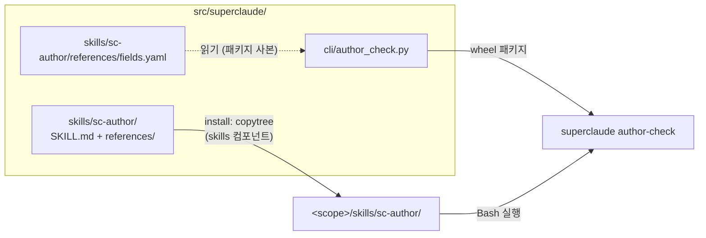

# `sc-author` 스킬 — 설계

유형: architecture. 다루는 것: 스킬 패키지 구성, 실행 흐름, 검사기(`superclaude author-check`) 인터페이스, `skills` 설치 컴포넌트, 검증 방법. 구현 코드는 다루지 않는다.

## 1. 입력

2026-10-10 세션에서 사용자가 정한 것:

| # | 결정 | 근거 |
|---|---|---|
| D1 | 배포판(`superclaude install`)에 넣는다. 대상은 SuperClaude를 설치한 사용자 프로젝트 | 사용자: "superclaude를 설치하여 사용하는 프로젝트에서 추가로 만들 때 너무 형식없이 만들어져" |
| D2 | 기본 형식은 Claude Code·Anthropic 공식 권장 구조(`--md`) | 사용자 선택 |
| D3 | `--xml` 플래그로 SuperClaude식 XML 본문도 지원 | 사용자 요청 |
| D4 | **명시 호출만** (`/sc-author`). 모델 자동 발동 없음 → `disable-model-invocation: true` | 리뷰 후 사용자: "스킬을 명시적으로 발동시킨다. 자동 발동이 아니다." (처음엔 자동 트리거였음) |
| D5 | 커맨드가 아니라 스킬로 배포 | 사용자: "skill이 더 좋지 않아?" → 참고 파일 묶음이 핵심 |
| D6 | XML 규칙 검증 필요 (검사기) | 사용자 |
| D7 | 선행 수정: 저장소 규칙의 사실 오류 정정 | 커밋 `95d77d84` |
| D8 | `--xml` 허용 범위: skill·agent·command·memory. output style만 md 고정 | 인터뷰 |
| D9 | 스킬 이름 `sc-author` (`/sc-author`) | 인터뷰 |
| D10 | **references는 사용자 프로젝트용으로 독립 작성.** 저장소 rules(`xml-prose-format.md`, `content-quality.md`)는 그대로 두고 import 관계도 두지 않음 | 리뷰 후 사용자: rules와 "비슷하지만 다르게 만들어야" → 독자·형식 범위·기본 형식이 다름 (§9) |

- 리뷰 전 설계(커밋 `49e0402c`)의 "XML·품질 규칙 원본을 배포 파일로 옮기고 저장소 rules가 `@import`" 안은 D10으로 폐기

외부 근거 (2026-10-10 조회, 문서에 날짜 없음 → 조회일 기준):

- Skill authoring best practices — `platform.claude.com/docs/en/agents-and-tools/agent-skills/best-practices`
- Claude Code skills / sub-agents / output-styles / memory — `code.claude.com/docs/en/{skills,sub-agents,output-styles,memory}`
- Prompting best practices — `platform.claude.com/docs/en/build-with-claude/prompt-engineering/claude-prompting-best-practices`
- `anthropics/skills` skill-creator, `obra/superpowers` writing-skills, `anthropics/claude-plugins-official` plugin-dev·claude-md-management

## 2. 범위

포함:
- 문서 유형 5종: `skill`, `agent`, `command`, `output-style`, `memory`(CLAUDE.md, CLAUDE.local.md, AGENTS.md, `.claude/rules/*.md`)
- 새로 쓰기 + 기존 파일 고치기(감사 → diff → 승인 → 쓰기)
- 형식 선택: `--md` | `--xml` | 미지정
- 기계 검사: frontmatter, 필드, 길이, 참조, XML 구조
- `skills` 설치 컴포넌트 (install / uninstall / git-exclude / verify-drift / inventory)

제외:
- mode, MCP 문서: SuperClaude `context_loader` 전용 개념
- hooks 작성: `update-config` 스킬이 담당
- 평범한 요청("에이전트 만들어줘")에서 자동 적용: D4로 제외 (§8)
- claude.ai·Codex 이식성: `portable-skills/` 경로가 따로 있음
- SuperClaude 자체 콘텐츠 작성: 저장소 `.claude/rules/`가 담당 (D10)

## 3. 아키텍처

### 3.1 배포 경로



- `<scope>`: user → `~/.claude/`, project·local → `./.claude/` (`install_paths.get_base_path`)
- `fields.yaml`은 스킬(설치본, 모델이 읽음)과 검사기(패키지 사본, 코드가 읽음)가 같은 원본에서 나옴. CLI만 업그레이드하고 `install`을 다시 안 돌리면 두 사본이 어긋남 → `superclaude verify-drift`가 잡음

### 3.2 실행 흐름


- Check 반복 상한 3회 → 넘으면 남은 error를 보고하고 멈춤

## 4. 컴포넌트와 인터페이스 계약

### C1. 스킬 패키지

```
src/superclaude/skills/sc-author/
├── SKILL.md                 절차만 (목표 ≤150줄)
└── references/
    ├── fields.yaml          유형별 frontmatter 필드 (검사기도 읽음)
    ├── skill.md             위치·frontmatter·md 본문 템플릿·유형 함정
    ├── agent.md
    ├── command.md           legacy 안내 + skill 권장
    ├── output-style.md
    ├── memory.md            CLAUDE.md·AGENTS.md·.claude/rules
    ├── format-xml.md        사용자 문서용 XML 본문 규칙 + skill·agent·command·memory 골격
    └── quality.md           사용자 문서용 품질 기준 + 감사 체크리스트
```

- 모든 references는 사용자 프로젝트를 독자로 독립 작성 (D10). 저장소 rules를 링크·import하지 않음 (`install-tree-boundary` gotcha: 설치본이 저장소 파일을 가리키면 사용자 기기에서 깨짐)
- 참조 깊이 1단계: 모든 참고 파일은 SKILL.md에서 직접 링크. 참고 파일끼리 링크하지 않음
- 100줄 넘는 참고 파일은 맨 위에 목차
- md 형식 규칙은 별도 파일 없이 각 `<type>.md` 템플릿에 포함 (§8)
- 경로 표기: `${CLAUDE_SKILL_DIR}/references/<file>` (Claude Code가 본문에서 치환)

### C2. SKILL.md 계약

frontmatter:

| 필드 | 값 |
|---|---|
| `name` | `sc-author` → 호출 `/sc-author` |
| `description` | `/` 메뉴에 보이는 한 줄 능력 설명. 모델 컨텍스트에 안 들어가므로 트리거·부정 게이트 불필요 |
| `disable-model-invocation` | `true` (D4) — 모델 목록에서 빠짐 → 목록 예산 비용 0, 오발동 0 |
| `argument-hint` | `[skill|agent|command|output-style|memory] [무엇을] [--md|--xml]` |
| `allowed-tools` | `Bash(superclaude author-check *)` + Windows용 PowerShell 규칙 (문법은 plan에서 확인, §9 R-S2) |

description 초안 (영어 — 배포 콘텐츠는 언어 중립):

> Write or revise a skill, subagent, slash command, output style, CLAUDE.md or .claude/rules file with valid frontmatter, a consistent body (--md default, --xml for XML bodies) and a validator pass.

본문 절차 (Numbered, 각 단계는 라벨로 시작):

1. Resolve
   - type: 인자 → 요청 문맥 → 모호하면 질문
   - path: 유형별 기본 위치(`fields.yaml`의 `location`) + scope(project 기본, 사용자가 개인용이라 하면 user)
   - format: `--xml` | `--md` | 미지정 → 기존 파일이면 현재 형식, 새 파일이면 md
   - `command` + 새 파일 → "Claude Code는 새 작업에 skill 권장" 안내 후 선택받기
   - `--xml` + `output-style` → md로 진행, 이유 한 줄 안내 (D8)
2. Load: `references/<type>.md` + (xml이면) `references/format-xml.md`
3. Draft | Audit
   - new → 템플릿으로 초안
   - existing → `quality.md` 체크리스트 + 검사기로 감사 보고 → diff 제시 → 승인 후 쓰기
4. Neighbors: 컨텍스트에 이미 있는 스킬 목록·에이전트 목록으로 이름과 트리거 겹침 확인 → 겹치면 description에 구분 문구. 파일은 읽지 않음
5. Check: `superclaude author-check <path> --type <t> --format <f>` → error 수정 → 재실행 (상한 3)
6. Hand-off: 새 세션에서 돌릴 프롬프트 2-3개 제시 (발동해야 할 것 1-2 + 비슷하지만 발동하면 안 되는 것 1). 만든 문서가 명시 호출 전용이면 호출 예시만

### C3. 참고 파일 계약

| 파일 | 담는 것 | 읽는 시점 |
|---|---|---|
| `fields.yaml` | 유형별 `location`, `required`, `optional`, `unsupported`(그 유형에서 Claude Code가 무시하는 필드), 길이 상한, 출처 URL + 조회일 | Resolve, Check(검사기) |
| `<type>.md` | 언제 이 유형을 쓰나(다른 유형과 구분) · md 본문 템플릿 · 유형 함정 | Load |
| `format-xml.md` | XML 본문 규칙 + skill/agent/command/memory 골격 | Load (`--xml`) |
| `quality.md` | 삭제 테스트, 트리거·설명문, 절차·참고 분리, 강한 용어, 내용 수명, 강조 대신 이유, 긍정형, 일관 용어, 예시 | Audit, Draft 마무리 |

유형 함정 (각 `<type>.md`에 들어갈 핵심):
- skill: description은 3인칭, 능력+트리거, 절차 요약 금지 · 본문 <500줄 · 참고 1단계 · 부작용 있는 작업은 `disable-model-invocation: true`
- agent: 본문이 곧 시스템 프롬프트 → 부모 대화 문맥 없음, 자기완결 · description = "언제 위임하나" · `name`에 `:` 금지
- command: `.claude/commands/`는 legacy · `name`, `paths` 미지원
- output-style: `keep-coding-instructions` 기본값 false → 코딩 프로젝트면 true · 사실·지식은 CLAUDE.md로
- memory: CLAUDE.md <200줄 · 구체적 지시("2칸 들여쓰기") · 서로 모순되는 지시 금지 · rules frontmatter는 `paths`만 읽힘 · 강제가 필요하면 hook · AGENTS.md는 CLAUDE.md가 없을 때만 읽힘

description 작성 기준 (`quality.md`, 출처 충돌의 해소): 능력은 몇 단어, 트리거는 구체적으로, 절차 요약 없음(obra: 요약하면 본문을 건너뜀), 대문자 강조 없음(프롬프트 가이드: 과잉 트리거).

### C4. 검사기 `superclaude author-check`

```
superclaude author-check <path> [--type skill|agent|command|output-style|memory]
                                [--format md|xml]
```

- `--type` 생략 → 경로로 추론: `*/skills/*/SKILL.md` → skill, `*/agents/*.md` → agent, `*/commands/**.md` → command, `*/output-styles/*.md` → output-style, `CLAUDE.md`·`CLAUDE.local.md`·`AGENTS.md`·`*/rules/**.md` → memory → 실패면 exit 2
- `--format` 생략 → frontmatter, 빈 줄, HTML 주석(`<!-- -->`), `@path` import 줄을 건너뛴 첫 줄이 태그면 xml, 아니면 md
- 태그 인식: `</?[a-z][a-z0-9_]*(\s[^>]*)?/?>` 패턴만 태그. `<3`, `<5KB`, `<=` 같은 산문 표기는 텍스트. 코드 펜스·인라인 코드는 가린 뒤 검사
- frontmatter 파싱: `yaml.safe_load` (남의 저장소 문서를 검사할 수 있음)
- 링크 해석: `${CLAUDE_SKILL_DIR}`를 검사 대상 스킬 디렉터리로 치환한 뒤 존재 확인
- 출력: 한 줄에 하나 `path:line: CODE message`, 마지막 줄 요약 `N errors, M warnings`
- exit: 0 = error 없음 · 1 = error 있음 · 2 = 사용법 오류·추론 실패
- 의존성: 표준 라이브러리 + PyYAML(이미 의존성)
- 위치: `src/superclaude/cli/author_check.py` + `main.py`에 click 명령 등록 (기존 `verify-drift`와 같은 평면 이름)

규칙:

| 코드 | 등급 | 조건 |
|---|---|---|
| F1 | error | frontmatter 없음(필요한 유형) 또는 YAML 파싱 실패 — Claude Code는 이 경우 필드 없이 조용히 로드 |
| F2 | error | `required` 필드 누락 |
| F3 | error | 그 유형의 `unsupported` 필드 사용 (예: command의 `name`·`paths`) — 조용히 무시됨 |
| F4 | warning | `fields.yaml`에 없는 필드 — Claude Code가 새 필드를 추가했을 수 있으므로 error 아님 |
| F5 | error | 이름 규칙 위반 (skill: 소문자·숫자·하이픈, ≤64 / agent: `:` 금지) |
| F6 | error | skill `description` + `when_to_use` > 1,536자 (목록에서 잘림) |
| F7 | warning | description 1인칭·2인칭 ("I can", "You can") |
| R1 | error | SKILL.md가 링크한 참고 파일 없음 |
| R2 | warning | 참고 파일이 다른 참고 파일을 링크 (깊이 >1) |
| R3 | warning | 100줄 넘는 참고 파일에 목차 없음 |
| S1 | warning | 길이 초과: SKILL.md >500줄, CLAUDE.md·rules >200줄 |
| S2 | warning | 대문자 강조어(MUST, ALWAYS, NEVER, CRITICAL, IMPORTANT) 3회 이상 |
| X1 | error | (xml) 루트 요소가 정확히 하나가 아님, 또는 루트 밖에 맨 텍스트. memory는 루트 앞의 `@path` 줄·HTML 주석 허용 |
| X2 | error | (xml) 태그 짝 불일치·잘못된 중첩 |
| X3 | error | (xml) 태그 이름이 `snake_case` 아님 |
| X4 | error | (xml) 요소 중첩이 4단 초과 (root → section → sub → item) |
| X5 | warning | (xml) `<example>` 밖 본문에 Markdown 헤더 |
| X6 | error | (xml) 슬롯 이름 `<should>`·`<avoid>` (모델이 선택 사항으로 읽음) |
| X7 | error | `--format xml`인데 output-style 유형 (D8 범위 밖) |

### C5. `skills` 설치 컴포넌트

현재 상태 (근거):
- `install_paths.COMPONENTS`에 skills 없음, `templates`만 하위 디렉터리를 `copytree` (`install_components.py:183-211`)
- `SHARED_TARGET_COMPONENTS = ("agents", "output-styles")` — 파일 이름 단위 (`shipped_md_names`)
- 커밋 `910eabdd`(2026-08-31)가 skills 레이어 전체 삭제 (`src/superclaude/cli/` 기준 662줄 삭제, 187줄 추가)

설계:

| 동작 | 계약 |
|---|---|
| install | `COMPONENTS["skills"] = ("skills", "skills", ...)` · 하위 디렉터리마다 copytree (templates 분기를 "디렉터리 컴포넌트" 공통 분기로 일반화) · 대상이 있으면 `--force`일 때만 교체, `_safe_target_path` 유지 |
| uninstall | 배포한 디렉터리 이름(`sc-author`)만 제거 — `.claude/skills`는 다른 도구와 공유 (`find_legacy_skills` 원칙) |
| git-exclude (local scope) | 디렉터리 단위 항목 `skills/sc-author/` |
| verify-drift | 디렉터리 컴포넌트는 하위 파일 재귀 비교 (`SKILL.md`, `references/*`) |
| inventory (`install --list-all`) | 디렉터리 수 집계 (`_source_dir_names` 재사용) |
| doctor | 별도 검사 추가 안 함 (§8) |
| legacy prune | `LEGACY_SKILL_NAMES` 그대로, `sc-author`와 겹치지 않음 |

### C6. 저장소 쪽 변경

| 파일 | 변경 |
|---|---|
| `.claude/rules/skill-authoring.md` (신규) | 저장소 규칙 "콘텐츠 유형마다 `*-authoring.md`" 준수. SuperClaude가 배포하는 스킬의 규칙: 이름 `sc-` 접두어, CC 전용 필드 허용, references는 사용자 프로젝트 독자용으로 독립 작성(D10), `content-quality.md`·`xml-prose-format.md`의 원칙을 바꾸면 `quality.md`·`format-xml.md`에 같은 변경이 필요한지 확인 |
| `.claude/rules/schemas.yaml` 주석 | `forbidden_command_fields`(SuperClaude 정책)와 `fields.yaml`(Claude Code가 지원하는 필드)의 관계 한 줄 |
| `AGENTS.md` Architecture | 설치되는 콘텐츠 목록 "(commands, agents, modes, output styles, MCP docs, core config)"에 skills 추가 |
| `agent-authoring.md:112`, `install_paths.py:186` | "ships no skills" 문구 갱신 |
| `src/superclaude/ARCHITECTURE.md` | taxonomy 표에 `skills/` 행 |
| `docs/codex/prompting_session_raw/02_component_and_delivery_map.md` §1 | `.py` 수·컴포넌트 수 재계산 (gotcha `codex-module-count-drift`) |
| README, CHANGELOG | 스킬 소개·설치 결과 |

`xml-prose-format.md`, `content-quality.md`는 변경 없음 (D10).

### C7. 검증

| 대상 | 방법 | 완료 조건 |
|---|---|---|
| 검사기 규칙 | 단위 테스트: 규칙 코드마다 위반 픽스처 1 + 통과 픽스처 1 | 모든 코드가 의도한 등급으로 발화 |
| 검사기 오탐 | 회귀 말뭉치: 배포되는 `src/superclaude/agents/*.md`, `commands/*.md`에 `--format xml`로 실행 | X1-X6 error 0 (산문 속 `<3`·`<5KB` 포함 문서가 이미 있음: `agents/project-manager.md:77`, `commands/pm.md:43`, `commands/index-repo.md:18`) |
| 스킬 구조 | 단위 테스트 + 자기 검사: `author-check`를 배포 스킬 자신에 실행 | error 0 |
| 설치 | install/uninstall 테스트: 3개 scope, 제3자 스킬 보존, local git-exclude 항목 | 기존 설치 테스트 + 신규 통과 |
| 효과 | `evals/tasks.yaml` 프로브, `sc-full` arm 안에서 비교: 같은 요청을 평문으로 vs `/sc-author`로 | `/sc-author` 쪽만 `author-check` exit 0 + 유형별 필수 구조 존재 → 차이가 스킬에서 나옴 |
| 명시 호출 | 같은 arm에서 평문 "agent 만들어줘" 실행 | 스킬 미발동 (`disable-model-invocation` 동작 확인) |

- 효과 프로브는 홈 디렉터리 기준 실행 (gotcha `probe-observer-effect`)

## 5. 제약

| 항목 | 값 | 출처 |
|---|---|---|
| skill description + when_to_use | 1,536자에서 잘림 (검사 대상 문서용) | CC skills 문서 |
| 이식용 description | ≤1,024자 | Agent Skills spec |
| skill name | 소문자·숫자·하이픈, ≤64 | best practices |
| SKILL.md 본문 | <500줄 | best practices |
| CLAUDE.md | <200줄 | CC memory 문서 |
| 참고 파일 목차 | >100줄이면 필요 | best practices |
| 문서 크기 | feature 문서 <25KB, Read 차단 30KB | RULES_DOCS, `file_size_guard` |
| 검사기 실행 | `superclaude`가 PATH에 있어야 함 — hook도 같은 전제 | `hook-console-entry` gotcha |
| Windows 셸 | Git Bash가 없으면 PowerShell 도구가 기본 → `Bash(...)` 허용 규칙이 적용 안 될 수 있음 | CC skills 문서 `shell` 필드 설명 |
| 경로 표기 | 슬래시(`/`)만 | best practices |

## 6. 형식 정책

| 유형 | `--md` | `--xml` |
|---|---|---|
| skill | 헤딩 + 번호 목록 절차 | `format-xml.md` 골격 |
| agent | 헤딩 + 역할·경계 섹션 | `format-xml.md` 골격 |
| command | skill과 동일 | `format-xml.md` 골격 |
| output-style | 일반 산문 | 미지원 → md (X7) |
| memory | 헤딩 + 불릿 | `@path` 줄(있으면) + XML 루트 하나 (X1 예외). rules·import되는 파일은 루트만 |

- frontmatter는 형식과 무관하게 YAML
- 기존 파일 + 플래그 없음 → 현재 형식 유지 (섞인 형식 방지)
- memory XML 근거: SuperClaude의 `CLAUDE_SC.md`는 `@` 줄만 두고 XML은 import되는 core 파일에 있음 → 이 구성이 실제로 동작 중

## 7. 필요성 검사 (R18)

| 컴포넌트 | 없으면 생기는 실패 | 판정 |
|---|---|---|
| C1 SKILL.md + 유형 참고 5개 | 사용자 프로젝트 문서가 형식 없이 생성됨 (D1 보고) | 유지 |
| C1 `fields.yaml` | 필드 목록이 참고 파일과 검사기 두 곳에 생겨 어긋남 | 유지 |
| C1 `format-xml.md` | `--xml`이 따를 규칙이 설치본에 없음 (`.claude/rules`는 미배포) | 유지 |
| C1 `quality.md` | 기존 파일 감사 기준 없음 | 유지 |
| C4 검사기 | Claude Code가 잘못된 필드·YAML을 오류 없이 무시 → 실패가 안 보임; XML 검증 요구(D6) | 유지 |
| C5 skills 컴포넌트 | 스킬이 설치되지 않음 | 유지 |
| C6 skill-authoring.md | 저장소 규칙 "유형마다 `*-authoring.md`" 위반, references와 rules가 말없이 어긋남 | 유지 |
| C7 프로브 | "형식 개선" 주장에 근거 없음 (R15) | 유지 |

## 8. 미룬 것 (deferred)

| 항목 | 미룬 이유 | 다시 볼 조건 |
|---|---|---|
| 평범한 요청에서의 자동 적용 (자동 트리거 또는 `.claude/` 쓰기 시 검사하는 PostToolUse 훅) | D4: 명시 호출만. 사용자가 `/sc-author`를 쓰지 않으면 D1 증상은 그대로 남음 — 수용한 한계 | 명시 호출만으로 부족하다는 보고가 있을 때 |
| 별도 `format-md.md` | md 규칙은 유형별 템플릿에 들어가면 충분 | 템플릿 간 md 규칙 중복이 관찰될 때 |
| doctor 검사 | verify-drift가 설치본 누락·변경을 이미 잡음 | 설치 실패 보고가 있을 때 |
| 저장소 테스트가 검사기 재사용 | SuperClaude 콘텐츠 규칙이 더 엄격, 기존 테스트로 충분 | 두 쪽 XML 검사가 어긋날 때 |
| 시간 민감 표현 검사 | 오탐 위험 대비 근거 부족 | 실제 사례가 쌓일 때 |
| `--json` 출력 | 소비자 없음 | CI 연동 요청 시 |

## 9. 결정 기록

인터뷰 (2026-10-10):

| # | 사안 | 결정 |
|---|---|---|
| 1 | skills 레이어 삭제(2026-08-31)를 되돌림 | 진행, 디렉터리 컴포넌트 하나로 제한. 이번엔 참고 파일 묶음이 실제로 필요 (D5) |
| 2 | 다른 명령은 `/sc:*`, 일반 스킬 이름엔 콜론 불가 | `sc-author` (D9). `sc-` 접두어가 공유 디렉터리에서 사용자 스킬과의 충돌 방지 |
| 3 | 자동 트리거 비용 | 리뷰 후 명시 호출로 바뀌어 해소 (D4) |
| 4 | `fields.yaml` 수명 | 미등록 필드 = warning(F4), 출처 URL·조회일 기록, 갱신 주기 미정 |
| 5 | 품질 원칙의 원본 위치 | 리뷰 후 독립 작성으로 바뀜 (D10) |
| 6 | description 작성법 출처 충돌 | C3 "description 작성 기준" |
| 7 | `--xml` 범위 | memory 허용, output style만 md (D8) |
| 8 | CC 전용 frontmatter로 이식성 없음 | 수용 (D1) |

리뷰 (`/sc:review`, 2026-10-10) 반영:

| 지적 | 처리 |
|---|---|
| I1 평범한 요청에서 미발동 위험, 프로브가 이를 시험 안 함 | D4로 명시 호출 전환 → 한계로 수용 (§8 첫 행), 프로브는 미발동 확인으로 바뀜 (C7) |
| I2 memory XML에서 `@` 줄이 X1 error | X1 예외 + §6 memory 형태 정의 |
| I3 산문 속 `<3` 등 X2 오탐 | C4 태그 인식 패턴 + C7 회귀 말뭉치 |
| I4 `@import` 이후 Codex가 규칙을 못 읽음 | D10으로 import 안 함 → 해당 없음 |
| I5 효과 프로브가 SuperClaude 전체 효과를 잼 | `sc-full` 안에서 평문 vs `/sc-author` 비교 (C7) |
| S1 Neighbors 파일 읽기 | 컨텍스트 목록 사용 (C2-4) |
| S2 Windows PowerShell 허용 규칙 | `allowed-tools`에 추가, 문법은 plan에서 확인 (C2, §5) |
| S3 `${CLAUDE_SKILL_DIR}` 링크 해석 | C4 링크 해석 |
| S4 HTML 주석 형식 오감지 | C4 `--format` 감지 규칙 |
| S5 `fields.yaml` 두 사본 어긋남 | §3.1, verify-drift가 잡음 |
| S6 `fields.yaml`·`schemas.yaml` 관계 | C6 `schemas.yaml` 주석 |
| S7 `yaml.safe_load` | C4 |
| S8 AGENTS.md를 memory에 포함할지 | 포함 (§2, C4 추론, C3 함정) |

남은 미결 사항: 없음. plan에서 확인: PowerShell 허용 규칙 문법.

## 10. 요구사항 커버리지

| 요구 | 반영 위치 |
|---|---|
| skill·agent·command 등 Claude가 읽는 문서 작성 스킬 | C1, C2, C3 |
| 배포판 포함, 사용자 프로젝트 대상 | C5, D1 |
| 형식 없이 만들어지는 문제 해결 (명시 호출 시) | C3 템플릿, C4 검사기, C7 효과 프로브 |
| `--xml` / `--md` 파라미터 | C2 Resolve, §6, D8 |
| 스킬로 배포, 명시 호출 | C1, C2 frontmatter, C5, D4 |
| references는 rules와 다르게 독립 작성 | C1, C6, D10 |
| XML 규칙 검증 | C4 X1-X7, C7 |

7/7 반영.
